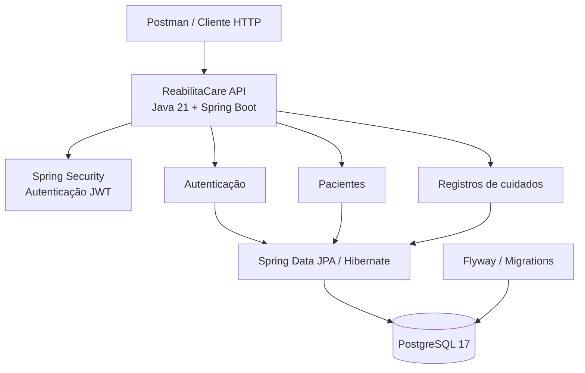
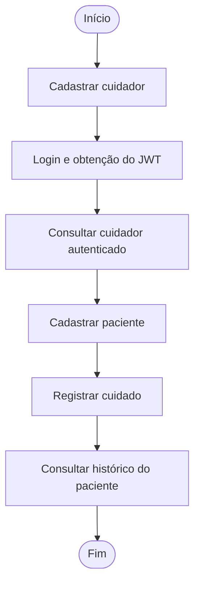
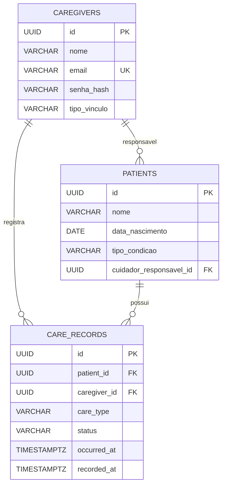

# ReabilitaCare

API REST para apoiar cuidadores familiares e profissionais. A API permite criar uma conta, entrar, consultar os próprios dados, cadastrar pacientes e registrar e consultar o histórico de cuidados de pacientes vinculados ao cuidador autenticado.

## Tecnologias utilizadas

<div align="center">

**Backend e segurança**


**Persistência e infraestrutura**


**Testes, documentação e automação**


</div>

Os ícones são carregados pelo serviço [Shields.io](https://shields.io/) quando o README é exibido on-line.

## Arquitetura e diagramas

O ReabilitaCare utiliza um **monólito modular**, organizado pelas funcionalidades de autenticação, pacientes e registros de cuidados. Os diagramas abaixo representam a arquitetura lógica, o fluxo principal da demonstração e os relacionamentos centrais do banco de dados.

### Arquitetura da aplicação



### Fluxo principal da demonstração



Um cuidado pode ser registrado como `REALIZADO` ou `NAO_REALIZADO`; no segundo caso, uma justificativa é obrigatória. A consulta de histórico exige que o paciente pertença ao cuidador autenticado.

### Modelo de dados simplificado



Os campos exibidos representam os principais atributos para compreender as relações, não todas as colunas das tabelas. As regras detalhadas estão nas migrations e na documentação das [decisões arquiteturais](docs/adr/0001-monolito-por-funcionalidade.md).

---

## Requisitos

- JDK 21
- Maven Wrapper incluído (`mvnw.cmd` no Windows)
- Docker Desktop com Docker Compose

O Wrapper usa Maven 3.10.0. No PowerShell, defina o JDK 21 somente na sessão atual:

```powershell
$env:JAVA_HOME = 'C:\Program Files\Java\jdk-21'
.\mvnw.cmd -version
```

## Configuração e execução

Os valores de `.env.example` são fictícios e somente para desenvolvimento local. Copie o arquivo e troque a chave de acesso por 32 bytes aleatórios:

```powershell
if (Test-Path .env) {
    throw 'Já existe um .env. Preserve-o e atualize-o manualmente.'
}
Copy-Item .env.example .env
$bytes = New-Object byte[] 32
$rng = [System.Security.Cryptography.RandomNumberGenerator]::Create()
$rng.GetBytes($bytes)
$key = [Convert]::ToBase64String($bytes)
$rng.Dispose()
(Get-Content .env) -replace '^ACCESS_TOKEN_SECRET_BASE64=.*$', "ACCESS_TOKEN_SECRET_BASE64=$key" |
    Set-Content .env
docker compose up --build
```

O `.env` está ignorado pelo Git. Nunca use os valores fictícios deste repositório fora do ambiente local. A aplicação exige URL, usuário e senha do banco e uma chave Base64 com pelo menos 32 bytes; segredo ausente ou curto impede a inicialização. O usuário do banco da aplicação não é superusuário.

Verifique a API em `http://localhost:8080/api/v1/health`. Para validar a configuração do Compose sem iniciar serviços:

```powershell
docker compose --env-file .env.example config --quiet
```

## Autenticação

Todos os exemplos usam dados fictícios e o domínio reservado `.test`. A senha de cadastro deve conter de 12 a 72 caracteres ASCII imprimíveis.

### Criar cuidador

`POST /api/v1/auth/register` — retorna `201 Created`. O email é normalizado para minúsculas e espaços externos são removidos.

```json
{
  "nome": "Cuidador Exemplo",
  "email": "cuidador@example.test",
  "senha": "ExemploSenha!2026",
  "tipoVinculo": "FAMILIAR"
}
```

Resposta resumida:

```json
{
  "id": "00000000-0000-4000-8000-000000000001",
  "nome": "Cuidador Exemplo",
  "email": "cuidador@example.test",
  "tipoVinculo": "FAMILIAR",
  "criadoEm": "2026-01-01T12:00:00Z",
  "ativo": true
}
```

`tipoVinculo` aceita `FAMILIAR` ou `PROFISSIONAL`. Campos desconhecidos não concedem permissões administrativas.

### Entrar

`POST /api/v1/auth/login` — retorna `200 OK`. Para email inexistente, senha incorreta ou conta inativa, retorna a mesma resposta genérica `401 Unauthorized`.

```json
{
  "email": "cuidador@example.test",
  "senha": "ExemploSenha!2026"
}
```

A resposta inclui um JWT Bearer de acesso válido por 15 minutos. O token deve ser enviado no cabeçalho `Authorization: Bearer <accessToken>`.

### Consultar a própria conta

`GET /api/v1/auth/me` — exige token válido e retorna somente o cuidador identificado pelo `sub` assinado no token. IDs enviados pelo cliente não selecionam a conta consultada. Sem autenticação, retorna `401 Unauthorized`.

`GET /api/v1/health` continua público.

## Pacientes

Todas as rotas abaixo exigem `Authorization: Bearer <accessToken>`. O identificador do cuidador é obtido exclusivamente do `sub` do JWT validado; o cliente não escolhe nem altera o cuidador responsável.

### Cadastrar paciente

`POST /api/v1/patients` — retorna `201 Created`.

```json
{
  "nome": "Paciente Exemplo",
  "dataNascimento": "1980-05-10",
  "tipoCondicao": "NAO_INFORMADO",
  "observacoesGerais": "Informação fictícia para exemplo."
}
```

`dataNascimento` e `observacoesGerais` são opcionais. A data não pode estar no futuro. `tipoCondicao` aceita `PARAPLEGIA`, `TETRAPLEGIA` ou `NAO_INFORMADO`; é apenas descritivo e não determina tratamentos ou nível de dependência. Observações têm limite de 2.000 caracteres.

### Listar pacientes

`GET /api/v1/patients?page=0&size=20` — retorna somente pacientes do cuidador autenticado. A paginação começa em zero; o tamanho padrão é 20 e o máximo é 50.

### Consultar e atualizar

- `GET /api/v1/patients/{id}` consulta um paciente do cuidador autenticado.
- `PUT /api/v1/patients/{id}` substitui os campos editáveis com nome, data de nascimento, tipo de condição e observações.

As respostas contêm dados do paciente e o UUID do cuidador responsável, mas nunca entidades JPA. O cuidador responsável não pode ser alterado. Paciente inexistente ou pertencente a outro cuidador retorna o mesmo `404 Not Found` e a mesma mensagem.

Exemplo de resposta resumida:

```json
{
  "id": "00000000-0000-4000-8000-000000000002",
  "nome": "Paciente Exemplo",
  "dataNascimento": "1980-05-10",
  "tipoCondicao": "NAO_INFORMADO",
  "observacoesGerais": "Informação fictícia para exemplo.",
  "cuidadorResponsavelId": "00000000-0000-4000-8000-000000000001",
  "criadoEm": "2026-01-01T12:00:00Z",
  "atualizadoEm": "2026-01-01T12:00:00Z"
}
```

## Diário de cuidados

Os registros são administrativos: não recomendam medicamentos, doses, procedimentos nem frequência de cuidados, e não substituem orientação profissional. Todas as rotas abaixo exigem JWT Bearer válido e paciente pertencente ao cuidador autenticado.

### Registrar cuidado

`POST /api/v1/patients/{patientId}/care-records` — retorna `201 Created`.

```json
{
  "careType": "HIDRATACAO",
  "status": "REALIZADO",
  "occurredAt": "2026-11-14T09:15:00-03:00",
  "notes": "Registro fictício.",
  "reasonNotPerformed": null
}
```

`occurredAt` exige data e horário ISO 8601 com offset. O instante é normalizado para UTC ao persistir e é devolvido em UTC. Horários até dois minutos à frente do relógio do servidor são aceitos para tolerar diferenças pequenas entre relógios; valores além disso retornam `400`. `recordedAt` é gerado pelo servidor e não pode ser informado pelo cliente.

`notes` é opcional e limitado a 2.000 caracteres. Para `NAO_REALIZADO`, `reasonNotPerformed` deve conter um motivo (até 500 caracteres); para `REALIZADO`, o motivo deve ser omitido ou nulo. Categoria, status e horários inválidos retornam `400`.

Os status aceitos são `REALIZADO` e `NAO_REALIZADO`. Categorias administrativas:

| Categoria | Descrição simples |
|---|---|
| `HIGIENE` | Higiene pessoal |
| `ALIMENTACAO` | Alimentação |
| `HIDRATACAO` | Líquidos ingeridos |
| `POSICIONAMENTO` | Mudança de posição |
| `MOBILIDADE` | Auxílio para movimentação |
| `CUIDADOS_PELE` | Observação e cuidados com a pele |
| `ELIMINACAO_URINARIA` | Urina |
| `ELIMINACAO_INTESTINAL` | Evacuação |
| `MEDICAMENTO` | Registro de cuidado relacionado a medicamento prescrito |
| `BEM_ESTAR` | Bem-estar e observações emocionais |
| `OUTROS` | Outros cuidados |

### Consultar histórico e registro

- `GET /api/v1/patients/{patientId}/care-records?page=0&size=20` lista o histórico em ordem decrescente de `occurredAt`, com UUID como desempate estável. `size` padrão: 20; máximo: 50.
- Filtros opcionais: `from`, `to` (timestamps ISO 8601 com offset, inclusivos) e `careType`. Exemplo: `?from=2026-11-13T00:00:00Z&to=2026-11-15T00:00:00Z&careType=HIGIENE`. Início posterior ao fim retorna `400`.
- `GET /api/v1/patients/{patientId}/care-records/{recordId}` consulta um registro somente no contexto do paciente autorizado. Registro de outro paciente e registro inexistente retornam `404`.

O DTO de resposta contém os UUIDs do paciente e do cuidador que registrou o evento, mas não dados de conta do cuidador. As consultas no banco filtram pelo paciente e cuidador autenticado; `caregiverId` enviado pelo cliente não determina autoria. Nesta etapa não existem rotas de edição ou exclusão: os registros são preservados para rastreabilidade. Um mecanismo auditável de retificação deve ser projetado antes do uso real.

### Erros

As respostas de erro usam `{ "code": "...", "message": "..." }`. Cadastro inválido retorna `400`, email duplicado retorna `409`, credenciais inválidas retornam `401`, e acesso não autorizado a uma operação retorna `403` ou `401`, conforme o caso. As mensagens não repetem valores enviados pelo cliente.

## OpenAPI

A especificação OpenAPI 3 e o Swagger UI ficam desabilitados por padrão. Para desenvolvimento local controlado, defina `OPENAPI_ENABLED=true` no `.env` antes de iniciar a aplicação; quando ativados, `GET /v3/api-docs` e `/swagger-ui.html` são públicos. Mantenha `OPENAPI_ENABLED=false` em implantações públicas. Os testes de integração habilitam esses recursos somente no contexto de teste.

## Observabilidade

Cada resposta inclui `X-Correlation-ID`. Um identificador recebido só é aceito se tiver de 1 a 64 caracteres alfanuméricos, ponto, hífen ou sublinhado; caso contrário, a API gera um UUID. O identificador fica no MDC durante a requisição. Os logs de console são JSON e registram apenas método HTTP e status da resposta junto ao identificador; corpo, URI, cabeçalhos, tokens, credenciais e dados pessoais ou clínicos não são registrados pelo filtro.

`GET /actuator/health` continua público. `GET /actuator/prometheus` expõe métricas JVM e HTTP e exige JWT válido; os demais endpoints Actuator permanecem fechados. Não há usuário ou token dedicado para scraping nesta versão. Mantenha a coleta em rede privada e não publique o endpoint diretamente. Os SLOs iniciais, suas fórmulas e limitações estão em [Observabilidade e SLO](docs/observabilidade.md); são metas, não resultados medidos.

## Desempenho

Os cenários k6 locais, metodologia e resultados medidos estão em [Testes de desempenho](docs/desempenho.md). Os scripts ficam em `tests/performance/`: smoke de 30 segundos e SLO local de 5 minutos. São testes de leitura, exigem token de uma conta fictícia isolada e não devem ser executados contra produção. A documentação separa evidências locais de resultados de CI; nenhum resultado de produção é declarado.


## Demonstração com Postman

A Collection Postman v2.1 está em [`tests/postman/reabilitacare.postman_collection.json`](tests/postman/reabilitacare.postman_collection.json). Com a API disponível em `http://127.0.0.1:8080`, importe o arquivo no Postman em **Import** e execute **Run collection** com uma iteração, mantendo a ordem das seis requisições:

1. Cadastro de cuidador (`POST /api/v1/auth/register`).
2. Login (`POST /api/v1/auth/login`).
3. Consulta da conta (`GET /api/v1/auth/me`).
4. Cadastro de paciente (`POST /api/v1/patients`).
5. Registro de cuidado (`POST /api/v1/patients/{patientId}/care-records`).
6. Consulta do histórico (`GET /api/v1/patients/{patientId}/care-records`).

A Collection gera dados fictícios, usa somente **variáveis da própria Collection** (`baseUrl`, `email`, `senha`, `token`, `patientId`, `recordId` e `occurredAt`) e captura automaticamente os identificadores e o JWT. Os testes conferem os status HTTP e a presença do registro criado no histórico. Não execute a demonstração com dados reais nem compartilhe tokens de acesso.

Opcionalmente, com o Newman instalado, execute na raiz do projeto:

```powershell
newman run tests/postman/rehabilitacare.postman_collection.json
```

## Testes, compilação e cobertura

```powershell
$env:JAVA_HOME = 'C:\Program Files\Java\jdk-21'
.\mvnw.cmd clean verify
```

`verify` executa Checkstyle, testes unitários, testes HTTP de integração com PostgreSQL 17 via Testcontainers, validação do contrato OpenAPI, relatório JaCoCo e gate de cobertura mínima de 70% das linhas. O mesmo comando roda no GitHub Actions em push e pull request para `main`; a execução do CI exige Docker disponível para o Testcontainers.

## Persistência e migrações

Flyway cria `caregivers`, `patients` e `care_records` nas migrations V1, V2 e `V3__create_care_records.sql`. A tabela de registros tem chaves estrangeiras para paciente e cuidador, restrições para categorias e status e índice para histórico cronológico por paciente. Hibernate valida o esquema (`ddl-auto=validate`) e não cria ou atualiza tabelas. A senha é armazenada com BCrypt; DTOs não incluem senha nem hash.

## Segurança e limitações conhecidas

- JWT HS256 assinado com chave configurada fora do código; a chave local fictícia não deve ser reutilizada.
- Senhas protegidas com BCrypt (fator 12); tentativas de login inválidas recebem resposta genérica.
- Rotas fechadas por padrão; saúde, OpenAPI, cadastro/login, `me`, pacientes, diário e métricas têm regras explícitas. A especificação OpenAPI é pública; métricas Prometheus exigem JWT.
- As consultas e atualizações de pacientes incluem o UUID do cuidador autenticado no filtro de persistência. Cada paciente tem um único cuidador responsável nesta versão; equipes e compartilhamento não são suportados.
- Os registros são imutáveis na API atual. Não há retificação auditável; por isso, o diário não deve ser usado para rastreabilidade operacional real até que essa capacidade seja especificada e implementada.
- Não há contas administrativas públicas, renovação de token, logout/revogação imediata nem limitação de tentativas por IP/conta. O token expira em 15 minutos; limitação de força bruta e gestão de chaves são pendências antes de exposição pública.
- Esta API registra apenas dados informados e não recomenda tratamentos. Não registre tokens, senhas, hashes, dados pessoais ou dados clínicos. Não use dados reais nos testes.

A identidade, autoria e armazenamento de instantes dos registros seguem [ADR 0004](docs/adr/0004-registro-imutavel-de-cuidados.md). A decisão sobre JWT e seus trade-offs está registrada em [ADR 0002](docs/adr/0002-autenticacao-jwt.md). A relação de um cuidador responsável por paciente está em [ADR 0003](docs/adr/0003-cuidador-responsavel-por-paciente.md). A decisão inicial de arquitetura está em [ADR 0001](docs/adr/0001-monolito-por-funcionalidade.md).
